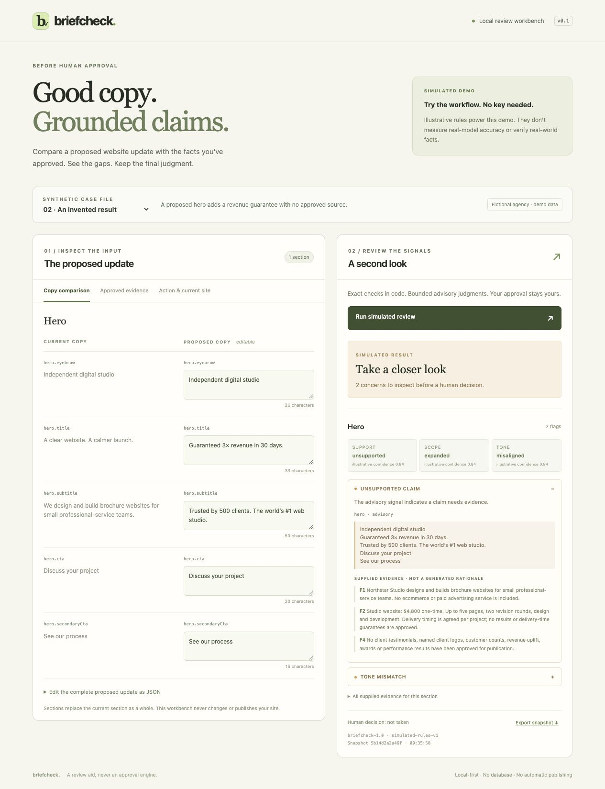

# BriefCheck

A small, local-first review workbench for proposed agency website-copy updates. Compare the current copy, a pending whole-section replacement, and operator-approved facts. Get exact checks in code plus advisory judgments from decision models before a human makes the real decision.

For example, if the approved price is $2,500 and proposed copy says $1,500, an exact constraint flags the mismatch. A decision model separately checks whether claims are supported, promises have expanded, and the tone fits the brief. BriefCheck uses hosted decision models; it does not train or supply its own model.

**Default: an explicitly labelled simulator. No API key, network inference, paid service, signup, database, or hosting is needed.** This is a working prototype, not a factuality guarantee, approval engine, prompt-injection defense, or installed Vetta/Naïve integration.



*Fictional example in simulator mode. The screenshot illustrates the review workflow; its confidence values are synthetic. A recorded live-provider connection test is linked below.*

## Run locally

Node **22.12+** (most recent local verification: 22.21.0) and npm. From this directory:

```sh
npm ci
npm run check
npm start
```

Open **http://127.0.0.1:3000**. `npm start` serves the built React UI and Node API from one loopback-only process. Build first. `npm run dev` uses Vite middleware and Node watch mode with the `tsx` import hook, also on port 3000. Both development and production start optionally load `.env` using Node; exported environment variables take precedence. No environment file is required for simulation.

If the environment cannot write npm's default cache, use `npm ci --cache /tmp/briefcheck-npm-cache`. If port 3000 is taken, use `PORT=3001 npm start`. No scripts create repositories, start Codex Cloud tasks, merge branches, or publish websites.

## Try the workflow

1. Choose one of four fictional Northstar Studio cases: careful rewrite, invented result, changed pricing, or instructions embedded in copy. These are demonstration scenarios, not an exhaustive list of issues the app can review.
2. Use **Copy comparison** to edit the replacement beside the current copy, **Approved evidence** to supply the facts it should respect, and **Action & current site** to inspect the pending action and existing site. The comparison shows before and after. Approved evidence means facts supplied by the operator, not facts independently verified or approved by BriefCheck.
3. Click **Run simulated review**, or **Run Decision Model review** when a live provider is configured. Inspect fixed reason labels such as exact mismatch or contradiction, actual input excerpts, and the facts supplied for each section. Evidence is contextual, not a generated explanation or proof of causation.
4. Export the evaluated JSON snapshot if useful. Every edit invalidates the visible report; an earlier request cannot attach its result to a newer input. No approval or publishing action exists.

The simulator uses a few transparent illustrative pattern rules. It will miss unsupported claims outside those patterns. Its displayed distributions/confidences are synthetic and **do not measure Jev or SubQ accuracy**. A no-flags result remains an invitation to inspect the evidence, never certification.

## What is checked

- Strict JSON shape, unknown keys, required current section shape, action identity, 30,000-character aggregate context cap, 64 KiB HTTP body cap, up to six proposed sections, 2,000 characters per string, and up to 24 items per list. Invalid/unsupported input yields an explicit error before inference.
- Deterministic equality for operator-specified exact constraints, blank required copy, a 1,200-character per-copy-field advisory limit, and a small instruction-like-text warning. Arithmetic/exact comparison stays in code. The warning regex is not a comprehensive injection detector.
- Three atomic Choice questions per reviewed section: factual support, added commitments/scope, and voice alignment. They receive that section's current/proposed excerpts, explicitly mapped approved facts, and voice guidance. Current copy is context, not authority.
- Missing evidence, uncertain choices, low confidence, contradictions, unsupported claims, tone conflicts, and errors remain review concerns. Confidence threshold **0.72** is an uncalibrated product routing choice, not a validated safety threshold. Facts can be incomplete, contradictory, or false; humans must validate the source pack.
- Supported section replacements: `company`, `tagline`, `tone`, `hero`, `proof`, `services`, `pricing`, `contact`, `footer`. The first version deliberately refuses `analytics`, `palette`, `whoWeServe`, `process`, `faq`, unknown sections, and partial nested replacements. Review these manually. No silently ignored noncopy changes.

## Live providers: optional and server-only

Both adapters have mocked HTTP-contract tests. **No live Jev requests have been run.** A single synthetic SubQ request succeeded on 2026-10-13; see the [recorded response](docs/subq-smoke-2026-10-13.json). That proves one account/request worked at that time, not model accuracy or a latency benchmark.

Choose one provider in your untracked `.env` after authorizing content transmission and any API charges:

| Provider setting | Key variable | Requested model | Fixed endpoint | Request timeout |
| --- | --- | --- | --- | --- |
| `BRIEFCHECK_PROVIDER=subq` | `SUBQ_API_KEY` | `subq-snap-preview` | `https://api.subq.ai/v1/systemone` | 60 seconds |
| `BRIEFCHECK_PROVIDER=typesafe` | `TYPESAFE_API_KEY` | `jev-1.13.0` | `https://api.typesafe.ai/v1/systemone` | 12 seconds |

For SubQ:

```dotenv
BRIEFCHECK_PROVIDER=subq
SUBQ_API_KEY=your-own-server-key
PORT=3000
```

Restart the server and reload the browser. The main UI uses the label **Decision Models**; the consent text identifies the actual provider and requires explicit transmission/cost acknowledgment for each snapshot. SubQ remains the provider in the example above. Setting a key alone does not enable real calls. Each provider reads only its own key variable; a SubQ key is never sent to TypeSafe. Exported environment variables override `.env`, so remove a previous shell provider override when switching. Do not put a key in any `VITE_*` variable, UI form, source file, shared screenshot, or report. `.env` is ignored.

Each review makes one request per eligible section, sequentially, at most six requests, with three questions per request. There are no automatic retries, redirects, or fallback to simulation. Authentication/model-access errors, insufficient credits (402), rate limits, timeouts, non-JSON, missing/invalid answers, unexpected models, oversized responses, and malformed probability distributions fail unavailable. Error bodies and keys are never logged or returned.

TypeSafe confidence is additionally checked against its documented formula. SubQ confidence is checked for a finite value from 0 to 1 and retained as reported; its Decisions docs do not specify that formula. The existing 0.72 threshold remains an uncalibrated routing choice for both providers, not a comparable accuracy score. `subq-snap-preview` is a preview identifier, not an immutable model release.

Only the reviewed section's text, mapped facts, and tone go to the selected provider; action identity and unrelated site sections stay local. Read the provider's current terms/data handling before using private or client material. SubQ documents indefinite retention as its default, with organization-level alternatives. The included fictional examples are appropriate for initial connection tests. No SubQ multimodal or expanded-context capability is exposed by this text-only, bounded workbench.

## Tests and evaluation

```sh
npm run typecheck
npm test
npm run build
# Intentionally external and potentially billable; NOT part of check/test/build:
npm run eval:live -- --confirm-live-costs
```

The live smoke-evaluation script requires the explicit flag and `BRIEFCHECK_PROVIDER=subq` or `typesafe` plus that provider's key. It sends only the four synthetic cases, at most four requests, stops after a provider error, and prints complete reports. It is **not an accuracy benchmark**; those four cases also inform the simulator and are not a holdout set. See [evaluation plan](docs/evaluation.md) for the frozen train/holdout procedure to use before making accuracy claims. `node tests/qa.startup.mjs` explicitly uses simulation and fake keys even when a live `.env` exists.

Tests cover strict schemas, exact comparisons, true excerpts, synthetic scenarios, injection-like input handling, stale results, session isolation, server-only provider requests, response-contract failures, HTTP errors/concurrency, and the pinned pre-confirmation adapter. Independent review files, when present, describe their own test scope and infrastructure limits. See [QA report](docs/qa-report.md) and [adversarial review](docs/adversarial-review.md). Browser, mock-contract, and real-provider validation are different levels of evidence.

## Architecture

- `src/shared`: bounded data schema, report schema, reason vocabulary, canonicalization, and fictional fixtures.
- `src/server`: Express API; deterministic review and SHA-256 snapshot binding; simulator, TypeSafe and SubQ REST providers; atomic question definitions.
- `src/client`: React comparison workbench, safe text rendering, request-generation invalidation, input-bound report validation, and snapshot export.
- `integration`: original, minimal Naïve pending-action adapter and React advisory panel. [Wiring guide](docs/naive-integration.md).
- `tests`: Vitest unit, HTTP contract/integration, and independent QA/security regression tests.

`GET /api/config` reveals only public provider configuration. `POST /api/reviews` accepts the strict `ReviewInput` object and returns `{report}` or an explicit error. Both live providers require `X-BriefCheck-Live-Consent: 1`. An unavailable provider returns HTTP 502 with an unavailable report; malformed inputs return 400/413. Only one review can run at a time (409 for concurrent work). There is no report database, authentication, approval, execution, crawling, arbitrary-URL fetching, or deployment endpoint.

Each immutable report includes the full evaluated input, session/tool-call/target identity, evidence content hash, question/rubric/config-bound fingerprint, provider mode/requested and returned model, timestamp, raw typed answers, exact excerpts, deterministic disposition, and `humanDecision: not_taken`. Hashes bind snapshots; they are not signatures or authorization tokens. Exports contain supplied copy and facts, so share them only with appropriate recipients. Reports and keys are not persisted by the app; a browser download is user-controlled.

The service is intentionally single-user and loopback-only. It is **not safe to expose directly to the internet**. Production integration requires host authentication/authorization, trusted server-resolved evidence/action context, tenant isolation, request budgets, concurrency/rate limits, and a fresh review of data handling. Copy can contain malicious instructions. Jev's own docs warn that adversarial state can steer decisions, so this report can never be a security boundary.

## Sources and attribution

Official documentation checked 2026-10-11: [HTTP API](https://docs.typesafe.ai/api), [models](https://docs.typesafe.ai/models), [confidence](https://docs.typesafe.ai/confidence), [Jev limitations](https://docs.typesafe.ai/model-jaggedness/jev-1.13).

SubQ documentation checked 2026-10-13: [Quickstart](https://docs.subq.ai/), [Decisions API](https://docs.subq.ai/endpoints/decisions-api/), [models](https://docs.subq.ai/using-the-api/models/), [data retention](https://docs.subq.ai/using-the-api/data-retention/).

Naïve contract reference: `usenaive/agency-blueprint` at [`012751bba8c4b167c3d8e66acdc102b85e35ccfe`](https://github.com/usenaive/agency-blueprint/tree/012751bba8c4b167c3d8e66acdc102b85e35ccfe). The adapter/panel are original implementation code based on the public action/schema interface; no upstream codebase or templates are copied. No affiliation or installed integration is claimed.
